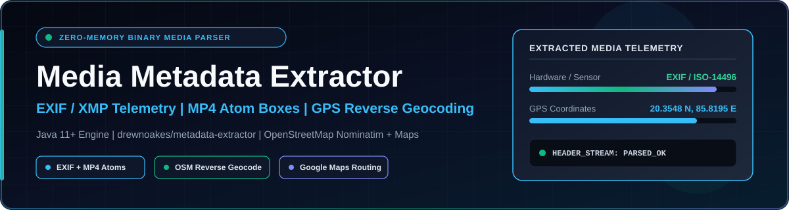
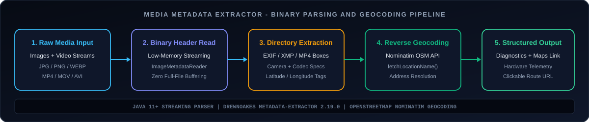
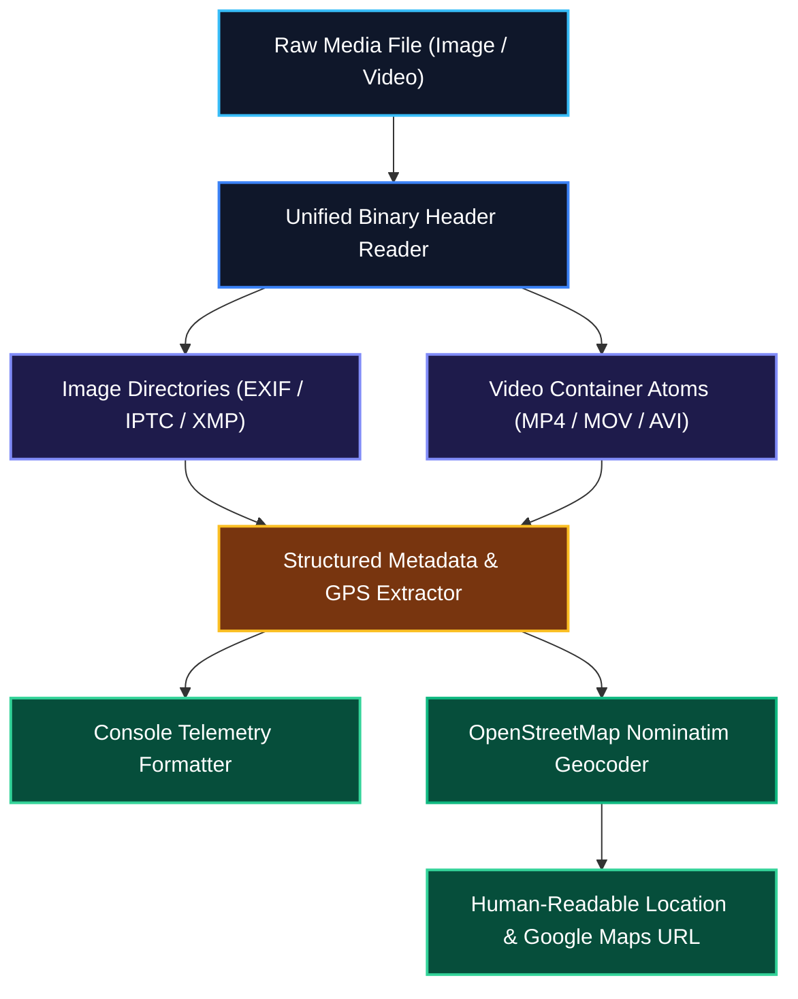

# 📷 Media Metadata Extractor (Java)

<div align="center">

  

  <br/><br/>

  
  
  
  
  

</div>

---

## 📌 Overview

**Media Metadata Extractor** (`MetadataExtractorProject`) is a lightweight, high-performance Java utility that extracts structured telemetry and geospatial metadata from digital images and video containers without loading entire media files into memory.

Built around the **drewnoakes/metadata-extractor** binary header-parsing engine and **OpenStreetMap (Nominatim)** reverse geocoding, it inspects camera hardware specifications, EXIF/XMP tags, MP4 atom boxes, and embedded GPS coordinates—converting raw coordinates into human-readable addresses and direct Google Maps links.

### 🎯 Core Objectives

- Parse binary headers of large image and video files with minimal memory footprint.
- Extract camera hardware details, exposure settings, timestamps, and codec parameters.
- Read embedded GPS latitude/longitude coordinates across both image EXIF directories and MP4 location atoms.
- Resolve raw GPS coordinates into readable street/city locations via OpenStreetMap Nominatim.
- Generate direct clickable Google Maps URLs for immediate geospatial verification.

---

## 🏗️ System Architecture & Processing Pipeline

<div align="center">

  

</div>

### Extraction & Geocoding Workflow



---

## ✨ Key Features

- **Zero-Memory Binary Header Parsing:** Streams only relevant header segments instead of buffering multi-gigabyte video or high-resolution image files into RAM.
- **Multi-Format Media Support:** Processes standard raster images (`JPG`, `JPEG`, `PNG`, `WEBP`) and video containers (`MP4`, `MOV`, `AVI`).
- **Hardware & Camera Diagnostics:** Extracts device make/model, focal length, aperture, ISO speed, resolution, and creation timestamps.
- **Cross-Format GPS Extraction:** Reads geospatial tags from both image EXIF GPS directories and MP4 ISO-14496 location atoms.
- **Automated Reverse Geocoding:** Queries OpenStreetMap's Nominatim API to translate coordinates into human-readable locations alongside clickable Google Maps routing links.

---

## 📦 Supported Media Formats

| Category | Supported Extensions | Extracted Metadata Scope |
|---|---|---|
| **Images** | `JPG`, `JPEG`, `PNG`, `WEBP` | EXIF, IPTC, XMP, Camera Hardware, Exposure Settings, GPS Coordinates |
| **Videos** | `MP4`, `MOV`, `AVI` | Container Atom Boxes, Codec/Stream Specs, Creation Date, GPS Location Tags |

---

## 🏛️ Core Module Architecture

### 1. `extractMediaProperties(String filePath)`
Primary extraction entry point responsible for orchestrating the inspection pipeline:
- Validates the target media path and detects file container format.
- Dispatches binary streams to Image EXIF or MP4 atom directory readers.
- Extracts hardware parameters and parses raw GPS latitude/longitude coordinates.
- Invokes the reverse geocoder when valid geospatial tags are present and outputs structured console diagnostics.

### 2. `fetchLocationName(double lat, double lon)`
Internal HTTP network layer handling geospatial resolution:
- Connects to the **OpenStreetMap (Nominatim)** reverse-geocoding endpoint.
- Resolves decimal latitude and longitude pairs into formatted human-readable place names.

---

## ⚙️ Setup & Local Execution

### Prerequisites

- **Java Development Kit (JDK):** Version 11 or higher
- **Apache Maven:** Version 3.6 or higher
- **Network Access:** Required for OpenStreetMap Nominatim reverse-geocoding lookups

### Maven Dependency

```xml
<dependency>
    <groupId>com.drewnoakes</groupId>
    <artifactId>metadata-extractor</artifactId>
    <version>2.19.0</version>
</dependency>
```

### 1. Clone the Repository

```bash
git clone [https://github.com/Aditya70-creator/MetadataExtractorProject.git](https://github.com/Aditya70-creator/MetadataExtractorProject.git)
cd MetadataExtractorProject
```

### 2. Configure Target Media File

Place a sample image or video inside the project directory and update the file path in `MetadataExtractorApp.java`:

```java
String filePath = "sample.jpg";
```

### 3. Compile and Run

```bash
mvn compile exec:java -Dexec.mainClass="MetadataExtractorApp"
```

---

## 🔌 Programmatic Integration

You can embed the extractor directly into Spring Boot file-upload services or Java backend pipelines:

```java
// Direct invocation on any local media path
MetadataExtractorApp.extractMediaProperties(
    "C:\\Users\\Desktop\\sample.mp4"
);
```

### Example Upload Service Integration

```java
public class UploadController {

    public void handleFileUpload(String path) {
        MetadataExtractorApp.extractMediaProperties(path);
    }

}
```

---

## 🤝 Contributing

1. Fork the repository.
2. Create a feature branch (`git checkout -b feature/MyFeature`).
3. Commit your changes (`git commit -m "Add new feature"`).
4. Push to the branch (`git push origin feature/MyFeature`).
5. Open a Pull Request.

---

## 🙏 Acknowledgements

- [drewnoakes/metadata-extractor](https://github.com/drewnoakes/metadata-extractor) — Binary metadata extraction engine for Java
- [OpenStreetMap / Nominatim](https://nominatim.openstreetmap.org/) — Open reverse-geocoding API
- Java & Apache Maven Community

---

## 📄 License

This project is licensed under the **MIT License**.

---

## 👨‍💻 Author

**Aditya Mitra**

- **GitHub:** [@Aditya70-creator](https://github.com/Aditya70-creator)
- **Repository:** [MetadataExtractorProject](https://github.com/Aditya70-creator/MetadataExtractorProject)

---

<div align="center">

  **Media Metadata Extractor**

  *Fast, low-memory media telemetry and geospatial extraction for Java.*

</div>